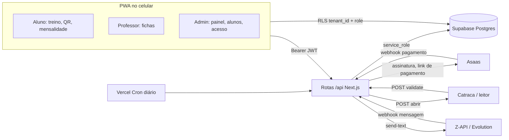
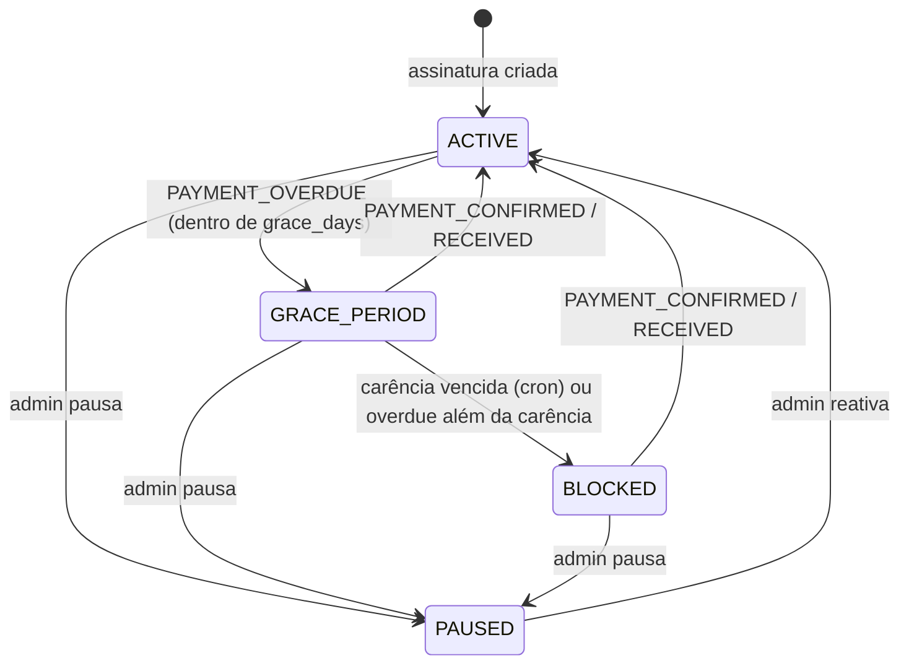
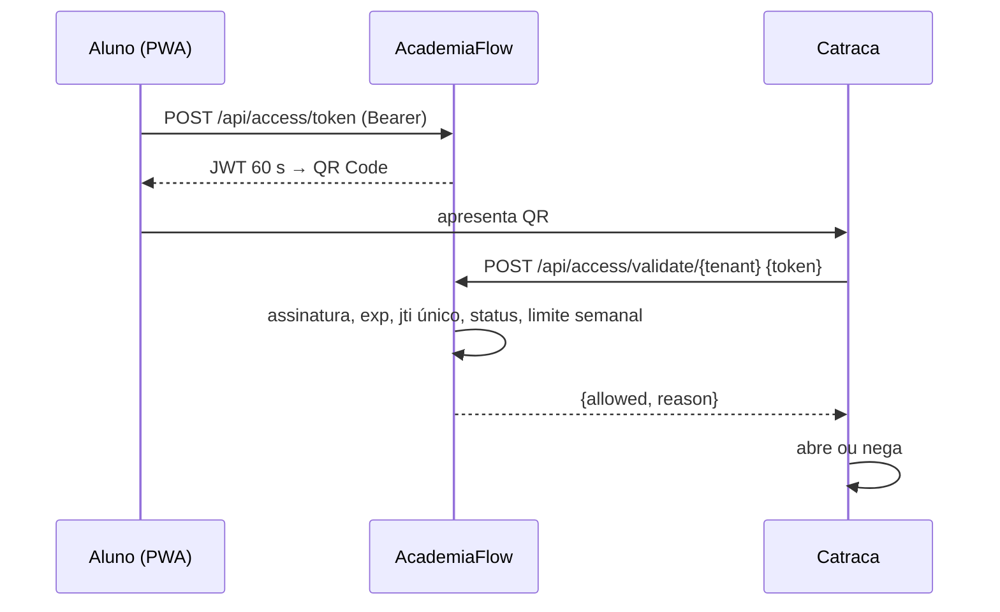

[README.md](https://github.com/user-attachments/files/35295092/README.md)
# AcademiaFlow (Micro-SaaS PWA)

PWA mobile-first para microacademias: treino offline, cobrança recorrente, controle de acesso (catraca/trava) e atendimento por WhatsApp.
Modelo: SaaS B2B multi-tenant (uma instalação atende várias academias, isoladas por `tenant_id` + RLS).

> **Status**: Etapas 1–6 implementadas. O código foi escrito sem rodar `npm install`, build ou testes (ambiente sem rede). Antes de produção, execute a seção [Validação](#validação-antes-de-produção) em um projeto Supabase de teste.

## Sumário
1. [Arquitetura](#arquitetura) · 2. [Setup local](#setup-local) · 3. [Variáveis de ambiente](#variáveis-de-ambiente) · 4. [Deploy HTTPS](#deploy-https-produção) · 5. [Webhooks e integrações](#webhooks-e-integrações) · 6. [Regras de negócio](#regras-de-negócio) · 7. [Checklist PWA](#checklist-pwa) · 8. [Validação](#validação-antes-de-produção) · 9. [Limitações](#limitações-conhecidas)

## Arquitetura
Next.js 14 (App Router) + Tailwind → Supabase (Postgres + Auth + RLS) → Vercel. Rotas `/api/*` rodam no servidor com a `service_role` (ignora RLS), por isso **sempre validam o chamador antes** (`getCaller`, token do gateway/catraca, segredo do webhook).



**Fluxo de cobrança**

Alunos `PAUSED`/`CANCELED` não são alterados por webhooks.

**Fluxo de acesso**


**Perfis (RLS)**: `ADMIN` tudo no tenant · `TRAINER` alunos (leitura) + CRUD de treinos, sem financeiro · `STUDENT` só os próprios dados.

## Setup local
```bash
npm install
cp .env.example .env.local     # preencha
# Supabase → SQL Editor: rodar supabase/migrations/0001 … 0006 em ordem
npm run dev                    # http://localhost:3000
```
1. Em `/login` → "Sou dono…" cria a conta; no primeiro login a academia e o ADMIN são criados e você cai no wizard `/onboarding`.
2. Wizard: horários → planos → gateway → catraca → WhatsApp → importar alunos (`exemplo-alunos.csv`).
3. Para testar Service Worker, offline e push use build de produção: `npm run build && npm start` (e HTTPS ou `localhost`).

## Variáveis de ambiente
Ver `.env.example`.

| Variável | Uso |
|---|---|
| `NEXT_PUBLIC_SUPABASE_URL`, `NEXT_PUBLIC_SUPABASE_ANON_KEY` | cliente (protegido por RLS) |
| `SUPABASE_SERVICE_ROLE_KEY` | **só servidor**; nunca com prefixo `NEXT_PUBLIC` |
| `NEXT_PUBLIC_APP_URL` | URL pública (mostrada no wizard para cadastrar webhooks) |
| `ACCESS_JWT_SECRET` | segredo do QR; `openssl rand -base64 32` |
| `NEXT_PUBLIC_VAPID_PUBLIC_KEY`, `VAPID_PRIVATE_KEY`, `VAPID_SUBJECT` | Web Push; `npx web-push generate-vapid-keys` |
| `CRON_SECRET` | autentica o cron (`Authorization: Bearer`) |

Chaves do gateway, da catraca e do WhatsApp ficam em `tenants.*_config` (preenchidas no wizard), não em variáveis de ambiente.

## Deploy HTTPS (produção)
1. **Supabase**: crie o projeto, rode as migrations 0001–0006. Em Auth → URL Configuration, defina *Site URL* = domínio de produção. Decida se exige confirmação de e-mail (o fluxo de cadastro suporta ambos).
2. **Vercel**: importe o repositório, cadastre todas as variáveis acima (Production), faça o deploy. HTTPS é automático e **obrigatório** para Service Worker, câmera, Web Push e QR.
3. **Domínio**: aponte o domínio e ajuste `NEXT_PUBLIC_APP_URL`; refaça o deploy.
4. **Cron**: `vercel.json` já agenda `/api/cron/billing` às 11:00 UTC (8h em Brasília). A Vercel envia `Authorization: Bearer $CRON_SECRET` automaticamente quando `CRON_SECRET` existe.
5. **Webhooks**: cadastre os três endereços abaixo em cada provedor (o wizard mostra as URLs exatas).
6. **Ícones**: substitua os placeholders em `public/icons/` (192, 512 e versão *maskable*).
7. **Antes de abrir para clientes**: criptografar `*_config` (Supabase Vault), ativar backups (PITR) e rever os termos LGPD com assessoria jurídica.

## Webhooks e integrações

### Pagamento (Asaas) — `POST /api/webhooks/payments/{tenantId}`
Painel Asaas → Integrações → Webhooks: URL acima, token = mesmo do wizard (header `asaas-access-token`), eventos `PAYMENT_CONFIRMED`, `PAYMENT_RECEIVED`, `PAYMENT_OVERDUE`.
```json
{ "id": "evt_05b708f961d739ea7eba7e4db318f621&1234", "event": "PAYMENT_OVERDUE",
  "payment": { "id": "pay_080225913252", "subscription": "sub_VXJBYgP2u0eO", "customer": "cus_000005113026",
               "value": 149.9, "dueDate": "2026-12-10", "status": "OVERDUE", "invoiceUrl": "https://www.asaas.com/i/080225913252" } }
```
Resposta: `200 {"ok":true,"result":"grace_period"}` · reentrega: `200 {"ok":true,"duplicate":true}` · token inválido: `401`. Falha interna devolve `500` e libera o evento para reenvio.

### Catraca/leitor — `POST /api/access/validate/{tenantId}`
Header `x-gate-token` (ou `Authorization: Bearer`) = token do passo "Catraca".
```json
// QR
{ "token": "<JWT lido do QR>" }
// leitor facial que já identificou a pessoa (exige consentimento LGPD)
{ "method": "FACE", "user_id": "<uuid>" }
```
```json
{ "allowed": false, "reason": "WEEKLY_LIMIT", "name": null }
```
`reason`: `BLOCKED`, `PAUSED`, `WEEKLY_LIMIT`, `NO_PLAN`, `NO_CONSENT`, `USER_NOT_FOUND`, `TOKEN_EXPIRED`, `TOKEN_INVALID`, `TOKEN_REUSED`.
- **JWT**: HS256 `{sub, tid, jti, iat, exp}`, 60 s, chave por academia `HMAC(ACCESS_JWT_SECRET, tenantId)`. O `jti` é de uso único: a catraca **não deve repetir** a chamada após timeout (peça um QR novo).
- **Fallback offline**: `GET /api/access/snapshot/{tenantId}` (mesmo header) devolve `{ key (base64), week_start, ttl_seconds, users: [{ id, weekly_limit, days_used }] }`. O controlador valida o JWT localmente com `key` e confere a lista, guarda as entradas offline e as reenvia depois. Sem nomes.
- **Abrir (AcademiaFlow → catraca)**, na liberação manual: `POST {gate_api_config.url}` com `Authorization: Bearer <token>` e `{ "action": "open", "reason": "MANUAL_OVERRIDE", "user_id": "<uuid|null>" }`. Timeout de 5 s.
- Cada fabricante de hardware costuma exigir um adaptador fino (gateway local) entre esta API e o equipamento.

### WhatsApp — `POST /api/webhooks/whatsapp/{tenantId}?secret=<segredo>`
O segredo é gerado no wizard (passo WhatsApp). Cadastre a URL no evento "mensagem recebida" do provedor.
```json
// Z-API
{ "phone": "5531988887777", "fromMe": false, "isGroup": false, "messageId": "3EB0...", "text": { "message": "3" } }
// Evolution API v2 (messages.upsert)
{ "event": "messages.upsert", "instance": "academia", "data": { "key": { "remoteJid": "5531988887777@s.whatsapp.net", "fromMe": false, "id": "3EB0..." }, "message": { "conversation": "3" } } }
```
Bot: **1** horários · **2** planos e preços · **3** link de pagamento (identifica o aluno pelo telefone; exige correspondência única nos últimos 8 dígitos). Qualquer outro texto mostra o menu. Mensagens duplicadas são ignoradas (idempotência por `messageId`). O sistema também envia por WhatsApp (se configurado) os avisos de carência, bloqueio e liberação, além do Web Push.

## Regras de negócio
- **Carência**: `tenants.grace_days` (padrão 2). Overdue → `GRACE_PERIOD` até `vencimento + grace_days`; passou disso → `BLOCKED`.
- **Limite semanal**: dias distintos de entrada, segunda a domingo (fuso São Paulo); voltar no mesmo dia não consome; plano sem limite = livre.
- **Painel** (`/admin`): *ativos* (em dia), *em carência*, *inadimplentes* = bloqueados por atraso, *entradas negadas* (7 dias), *MRR* = soma das mensalidades de planos ativos + em carência. Pausados aparecem à parte.
- **Pausa** (`/admin/alunos`): bloqueia a entrada, suspende a assinatura no Asaas e preserva o histórico. Reativar não perdoa dívida: o status é reajustado no próximo aviso do gateway.
- **LGPD**: consentimento no primeiro acesso (`/consent`); biometria facial só com consentimento. **Anonimização** sob solicitação: remove nome, contato, saúde, face, treinos, push e login, cancela a assinatura no gateway e mantém registros financeiros e de acesso sem identificação (guarda legal/auditoria).
- **Liberação manual**: motivo obrigatório; registrada em `access_logs` (`MANUAL_OVERRIDE`, `actor_id`) antes de acionar a catraca.

## Checklist PWA
- [x] `manifest.json` (standalone, ícones 192/512 + maskable) — **trocar os ícones placeholder**
- [x] Service Worker: shell, `/offline`, `/` e `/treino` abrem sem rede; push e clique em notificação
- [x] Treinos offline (IndexedDB), checklist de séries, Wake Lock
- [x] Banner de instalação (Android) e instrução iOS
- [x] Web Push (iOS 16.4+ só com o app instalado)
- [ ] Rodar auditoria no celular real (abaixo)

## Validação antes de produção
**Automática** (ambiente de teste, nunca produção): com o app rodando e as variáveis do Supabase de teste no ambiente,
```bash
npm run verify
```
cria duas academias descartáveis e confere: isolamento entre tenants, TRAINER sem financeiro, STUDENT sem escalar para ADMIN, webhook sem token (401), **idempotência** (2ª entrega = `duplicate`), carência → `BLOCKED` → `ACTIVE`, QR de uso único e catraca sem token (401). Limpa tudo ao final.

**Manual — offline**: `npm run build && npm start` → abra `/treino` logado, ative o modo avião, recarregue: a ficha e o checklist continuam funcionando; ao reconectar mostra "Atualizado".

**Manual — PWA / Lighthouse**: Chrome DevTools → Application → *Manifest* (sem erros, "Installable") e *Service Workers*. Em versões recentes o Lighthouse **removeu a categoria "PWA"**, então a meta "PWA ≥ 90" não é mensurável por ele; use a checagem de instalabilidade do DevTools e exija **Performance, Accessibility e Best Practices ≥ 90**:
```bash
npx lighthouse https://SEU-DOMINIO/login --only-categories=performance,accessibility,best-practices --form-factor=mobile
```
Se o desempenho ficar abaixo de 90, os candidatos são tamanho do bundle em `/onboarding` e `/treino` e ausência de imagens otimizadas.

## Limitações conhecidas
- Nada foi executado nesta sessão (sem rede): pode haver erros de tipo/compilação a corrigir no primeiro `npm run build`.
- Formatos de payload e endpoints de **Asaas, Z-API e Evolution** foram escritos de memória: confira a documentação atual e teste no sandbox. Em especial: campo `id` do evento do Asaas, `PUT /subscriptions/{id}` com `status` para pausar, e o envio de texto de cada provedor.
- Só o Asaas está implementado; Stripe e Pagar.me aparecem no wizard mas retornam erro explícito (integração isolada em `src/lib/gateway/`).
- A retentativa automática do cartão depende do gateway; o app bloqueia após a carência.
- Chaves de gateway/catraca/WhatsApp ficam em `jsonb` legível pelo ADMIN: mover para Vault/criptografia.
- O QR exige internet no celular; o fallback offline protege a catraca, não o aluno.
- Checklist de séries fica só no aparelho (sem tabela no schema da spec).
- Anonimização não apaga o cliente dentro do gateway nem arquivos de biometria (não há storage implementado ainda).
- Alunos importados por CSV recebem e-mail técnico; um login próprio (link por WhatsApp) ainda não existe.
- O bot identifica o aluno pelos últimos 8 dígitos do telefone: números duplicados na mesma academia caem em "fale com a recepção".
